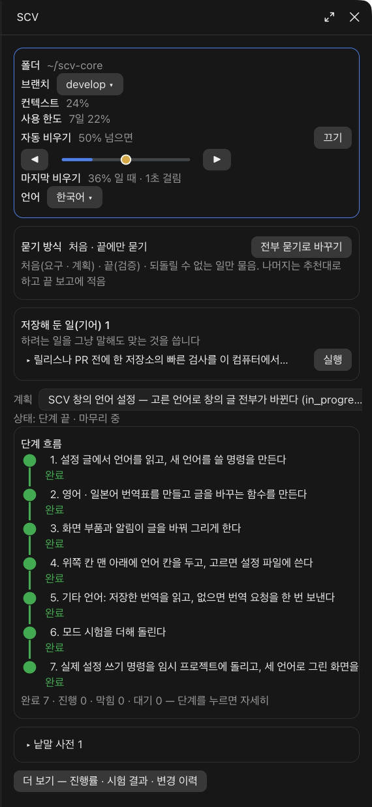
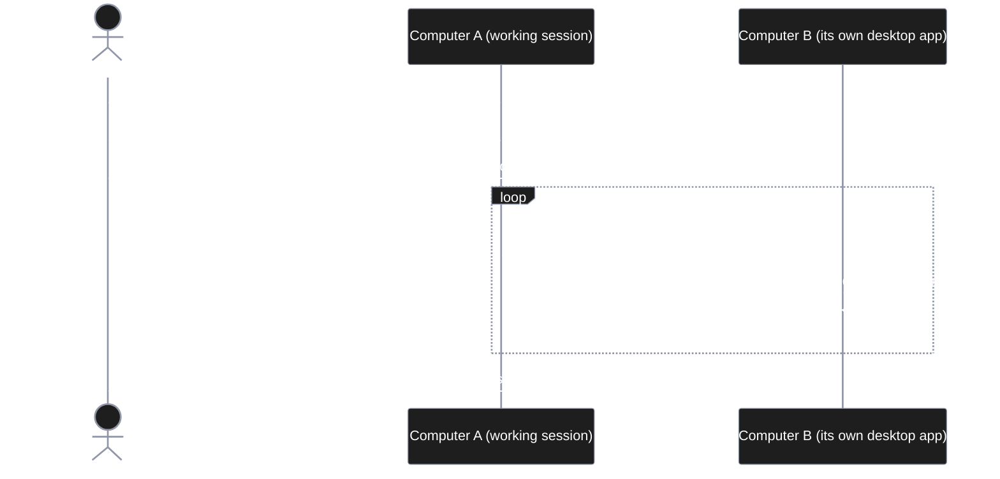

# scv-mods

Claude Code mods for the SCV workflow.

## Mods

- **scv-dashboard** — the SCV dashboard: an "SCV" pane beside the chat in the Claude desktop app. It shows where the plan stands, what Claude is doing now, and what waits on you, without reading the conversation.

<p align="center"></p>

<p align="center"><sub>A real session, shown in Korean — the pane also speaks English and Japanese.</sub></p>

## scv-dashboard: what the pane shows

It opens when a session starts. If you close it, it reopens on your next message, or type `/scv-dashboard`.

The project is the nearest folder at or above the session's folder that holds `scv/`. The pane reads that folder's plans (`scv/promote/*/PLAN.md` and `TESTS.md`); with no plan in progress, the newest archived plans stand in.

**Always on top**

- the folder and the branch — press the branch name to switch branch (git refuses a switch that would lose uncommitted work; no switch while Claude is working)
- context used and the usage limits (5-hour and 7-day windows, and when the 5-hour one resets)
- the ask mode (ask everywhere, or only at the start and the end) with a button that switches it
- auto-clear: on or off, and the threshold (%) on a slider
- the language of the pane: 한국어, English, 日本語, or type another language's name
- the gears of the project, each with a [Run] button
- the word dictionary: add, edit, delete

**The plan**

- a one-line summary: where the work stands, anything stuck, time left (an estimate, marked as one)
- the next thing to do, with a button that puts its command in the prompt box
- the step flow as connected nodes: done, doing, doing in the background, blocked, waiting
- motion that carries one meaning each: the step in progress pulses, a light runs to the next step when one finishes, and nothing moves while it is your turn (a button turns motion off)
- two jobs running at once: under the step they were split at, two columns (branch · original) with each job's steps; after the join, what changed and what to redo
- press a step — in the flow or in a column — to see what it does, what was done during it, and its evidence (pictures, videos, pages to open); a picture opens full size
- a plan picker when there are several plans

**The work**

- what Claude is doing now: the step, the tool and its file or command, elapsed time, the task list, one line per subagent
- background work, with the last line of its log
- test results per `TESTS.md` scenario, kept per project so a new session still shows them
- what happened since your last message

**What waits on you**

- an open question as a card on top: Claude's reading of the request (goal · not doing · check) or the evidence of the result, with buttons that answer it
- cards: waiting for your permission, a turn stopped by an error or a refusal, a failed test run
- alerts for the same, for a turn of 2 minutes or more that finished, and for a usage window past 90%; they also reach your phone while Remote Control is connected

Sections you do not need now fold under "more"; a blocked card never folds.

## scv-dashboard: what the pane does

| You press | What happens |
|---|---|
| [Run] on a gear | the pane runs it — no model call |
| [Run] on a gear that takes values | value fields open first |
| [Run] on a gear that reaches outside | it shows the step and waits for [Run] · [Cancel] |
| [Stop] | the running gear stops |
| the ask-mode button | the mode switches from the next message |
| the auto-clear switch · slider | saved in the project's settings |
| a language | the pane's text and Claude's answers follow it |
| the branch name | a branch list; pick one to switch |
| the next-step button | its command goes into the prompt box |
| an answer on the question card | the open question gets that answer |
| the motion button | the step pictures stop or move again |

**Auto-clear.** When a turn ends with the context past the threshold, the pane clears the conversation instead of summarizing it; the new conversation starts from the end of the SCV record. Right after, it shows the last three exchanges again (`/scv-last-talk`) and has Claude bring the task list back. The settings are `SCV_CLEAR_AUTO` and `SCV_CLEAR_PERCENT` in `scv/scv_settings.json` (default: on, 50%). A project with no SCV record is summarized as before.

**Language.** The choice is `SCV_LANG` in `scv/scv_settings.json`, the same setting that decides the language Claude answers in. For a language other than the three built in, Claude translates the pane's text once and saves it under `scv/dashboard-lang/`.

**Not drawn everywhere.** The pane is drawn only in a session opened in the desktop app. The terminal has no pane, and a Remote Control viewer (the desktop app on another computer, claude.ai, the phone) cannot draw it. To see it on another computer, mirror it — see [Mirror: the pane on another computer](#mirror-the-pane-on-another-computer).

## Mirror: the pane on another computer

1. In the working session on computer A, type `/scv-dashboard`. It prints the session's address (its Remote Control id while Remote Control is on).
2. On computer B, open a session in that computer's own desktop app and type `/scv-mirror <address>`.
3. B's SCV pane now shows A's state, sent between the two sessions and never read by either model.
4. The buttons work on B too: a press is sent to A's session, which does it (scv-dashboard 0.6.0 or later).
5. `/scv-mirror` alone says what it mirrors; `/scv-mirror stop` ends it.




Pitfalls:

- `/scv-mirror` typed in the working session itself fails: it is itself, so there is nowhere to send.
- A Remote Control viewer (claude.ai, the phone, another computer's remote view) cannot draw the pane. Open a session in computer B's own desktop app.
- Both computers need scv-dashboard 0.2.0 or later.

## Versions

Each mod has a version number, shown by `/scv:mods` and `claude plugin list`. What each version holds is in its release notes, one file per version, and on the repository's Releases page:

- scv-dashboard — [docs/releases/scv-dashboard](docs/releases/scv-dashboard/)

## Install

With SCV installed, type `/scv:mods-install` and pick `scv-dashboard`. Without it, at the prompt of a terminal session:

```
/plugin install scv-dashboard --marketplace wookiya1364/scv-mods
```

From a shell:

```
claude plugin install scv-dashboard --marketplace wookiya1364/scv-mods
```

In the desktop app: click + next to the prompt box, then Plugins, Add marketplace with `wookiya1364/scv-mods`, then Add plugin.

This repository is public, so anyone can install the mods with the lines above; no GitHub sign-in is needed.

## Update

`/scv:update` updates SCV and every installed mod; `/scv:mods` (SCV 0.70.0 or later) updates only the mods and lists them with their versions. From a shell instead:

```
claude plugin marketplace update scv-mods
claude plugin update scv-dashboard@scv-mods
```

Then run `/reload-plugins` in an open session. A mod updates only when its version changes, that is, with a release; commits between releases do not reach installed copies.

scv-dashboard was called scv-hello before its first release. On a machine that had scv-hello, install scv-dashboard once from a shell, then run `/reload-plugins`:

```
claude plugin install scv-dashboard@scv-mods
```

That command refreshes the marketplace before it looks the mod up, so it works on a machine whose copy of the marketplace still lists scv-hello.

The marketplace keeps a `renames` entry from the old name to the new one: once the marketplace is refreshed, Claude Code switches the setting to scv-dashboard and drops the scv-hello install by itself, so there is nothing to uninstall.

With SCV 0.70.0, `/scv:mods-install` lists only what the machine's copy of the marketplace already holds and does not refresh it first, so on such a machine it shows no mod to install, and `/scv:mods` stops on scv-hello with "not found".

## Releasing

Work goes on `develop`; `main`, which the marketplace serves, moves only with a release. A release is one command, `scripts/release.sh <mod> <version> --push`, and [docs/RELEASING.md](docs/RELEASING.md) has the steps.
