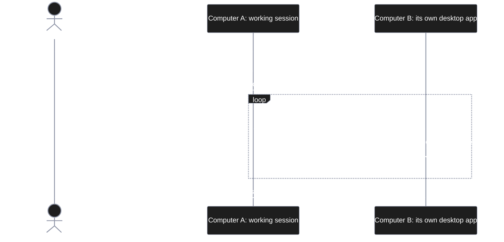

# scv-mods

Claude Code mods for the SCV workflow.

## Mods

- **scv-dashboard** — the SCV dashboard, in an "SCV" pane beside the chat in the Claude desktop app (local sessions). It reads the session folder's `scv/promote/*/PLAN.md` and `TESTS.md` (read only; with no plan in progress, the newest archived plans under `scv/archive/` stand in) and shows:
  - a one-line summary at the top (where the work stands · anything stuck · time left) and the next thing to do, with buttons that put its command in the prompt box (keeping what you typed; copied instead where the box will not take it) or copy it, and the same command offered as the prompt box's dim suggestion (Tab) when a turn ends; the plan status in plain words
  - plan progress (Suggested path steps done / total) with a traffic-light bar, and the stage flow as connected step nodes (done · doing · blocked · waiting, with a "지금 여기" tag where the work stands); steps are read from `[x]` / `[~]` / `[!]` marks merged with the step signals Claude sends while it works (the `scv_step` tool the mod registers, which asks no permission and changes no file; Claude is told about it only while a plan is open in `scv/promote`), else estimated from the plan status
  - what Claude is doing now: the step, the tool and its file or command, elapsed time, the todo list, and one line per subagent at work (five at most, the rest counted)
  - while you were away: what happened since your last message — steps finished, test runs and their outcome, and what waits on you
  - an estimated finish time from how long the steps took (always marked as an estimate)
  - blocked cards: waiting for your answer, waiting for your permission, a turn stopped by an error or a refusal, a failed test run
  - test results per TESTS.md scenario, from test commands run in a session; the last results are kept in the mod's own store per project folder, so a new session still shows them
  - the usage limits: how much of the 5-hour and 7-day windows is used and when the 5-hour one resets
  - alerts when Claude waits for your answer or your permission, a test run fails, a turn of 2 minutes or more finishes, a turn stops on an error or a refusal, or a usage window passes 90% (once per window): the app's notification, else the system's own, and Claude's own notification tool, which also reaches your phone while Remote Control is connected
  - the project is the nearest folder at or above the session's folder that holds `scv/`, so a session opened in a subfolder still sees its plans
  - the latest `/scv:dreams` summary, its improvement items, and a button that opens the report
  - press a step node to see what that step does, in plain words from the plan's pipeline table (its 하는 일 column), and what was done during it in this session; a step line names its pipeline steps after a dash: `3. Draw the pane — \`render\``
  - a plan picker when there are several plans; buttons to expand each section

  It opens when a session starts; if you close it, it reopens on your next message, or type `/scv-dashboard`. The terminal is not a target.

  A Remote Control viewer (the desktop app on another computer, claude.ai, the phone) cannot draw the pane. To see it on another computer, mirror it — see [Mirror: the pane on another computer](#mirror-the-pane-on-another-computer).

## Mirror: the pane on another computer

1. In the working session on computer A, type `/scv-dashboard`. It prints the session's address (its Remote Control id while Remote Control is on).
2. On computer B, open a session in that computer's own desktop app and type `/scv-mirror <address>`.
3. B's SCV pane now shows A's state, sent between the two sessions and never read by either model.
4. `/scv-mirror` alone says what it mirrors; `/scv-mirror stop` ends it.




Pitfalls:

- `/scv-mirror` typed in the working session itself fails: it is itself, so there is nowhere to send.
- A Remote Control viewer (claude.ai, the phone, another computer's remote view) cannot draw the pane. Open a session in computer B's own desktop app.
- Both computers need scv-dashboard 0.2.0 or later.

## Versions

Each mod has a version number, shown by `/scv:mods` and `claude plugin list`. What each version holds is in its release notes, one file per version, and on the repository's Releases page:

- scv-dashboard — [docs/releases/scv-dashboard](docs/releases/scv-dashboard/)

## Install

At the prompt of a terminal session:

```
/plugin install scv-dashboard --marketplace wookiya1364/scv-mods
```

From a shell:

```
claude plugin install scv-dashboard --marketplace wookiya1364/scv-mods
```

In the desktop app: click + next to the prompt box, then Plugins, Add marketplace with `wookiya1364/scv-mods`, then Add plugin.

This repository is public, so anyone can install the mods with the lines above; no GitHub sign-in is needed.

## Update

`/scv:mods` (SCV 0.70.0 or later) updates every installed mod and lists them with their versions. From a shell instead:

```
claude plugin marketplace update scv-mods
claude plugin update scv-dashboard@scv-mods
```

Then run `/reload-plugins` in an open session. A mod updates only when its version changes, that is, with a release; commits between releases do not reach installed copies.

scv-dashboard was called scv-hello before its first release. On a machine that had scv-hello, install scv-dashboard once from a shell, then run `/reload-plugins`:

```
claude plugin install scv-dashboard@scv-mods
```

That command refreshes the marketplace before it looks the mod up, so it works on a machine whose copy of the marketplace still lists scv-hello. The marketplace keeps a `renames` entry from the old name to the new one: once the marketplace is refreshed, Claude Code switches the setting to scv-dashboard and drops the scv-hello install by itself, so there is nothing to uninstall. With SCV 0.70.0, `/scv:mods-install` lists only what the machine's copy of the marketplace already holds and does not refresh it first, so on such a machine it shows no mod to install, and `/scv:mods` stops on scv-hello with "not found".

## Releasing

Work goes on `develop`; `main`, which the marketplace serves, moves only with a release. A release is one command, `scripts/release.sh <mod> <version> --push`, and [docs/RELEASING.md](docs/RELEASING.md) has the steps.
