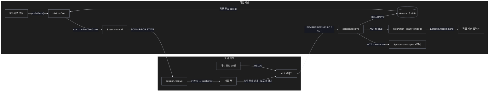
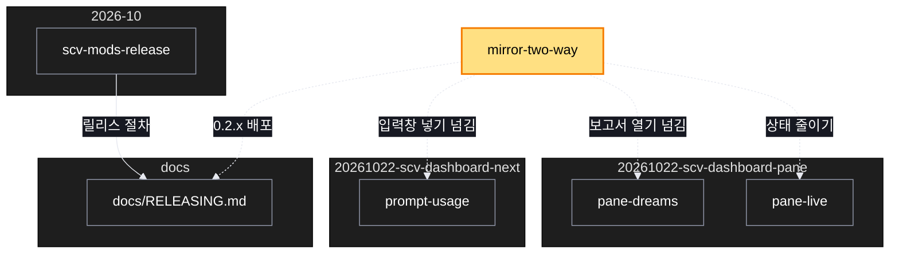

# Architecture — SCV 칸 — 거울 줄 줄이기와 거울 칸 동작 넘기기

> Two-diagram view of this feature. **Review and edit before `/scv:work`** —
> diagrams are LLM-generated and may have inaccuracies.

## 1. Component data flow

두 세션 사이로 거울 메시지가 오가는 길. 작업 세션은 바뀐 상태만 보내고, 보기 세션의 두 버튼은 ACT 로 작업 세션에 일을 맡긴다.



## 2. Position in whole architecture

이 기능은 scv-dashboard 칸 계획들 옆에 놓이고, 배포는 릴리스 절차를 따른다. 새 부분은 노란색.

> Source: scv graph (built 2026-10-25)



## 3. Screen mockups

### 거울 칸 (보기 세션)

```screen
{
  "title": "SCV 칸 — 거울 중",
  "body": [
    { "type": "text", "value": "거울: session_01WGaexNnnLkgorfoHsa7BiB · 12초 전 받음" },
    { "type": "card", "title": "다음: 시작하기", "body": [
      { "type": "button", "label": "입력창에 넣기", "variant": "primary", "marker": "A" },
      { "type": "button", "label": "명령 복사" },
      { "type": "text", "value": "작업 세션 입력창으로 보냄: /scv:work p" }
    ]},
    { "type": "card", "title": "드림", "body": [
      { "type": "button", "label": "보고서 열기", "marker": "B" }
    ]}
  ],
  "actions": [
    { "marker": "A", "title": "입력창에 넣기", "step": "mirrorText", "notes": ["거울 중이면 작업 세션에 ACT fill(slug) 를 보냄", "작업 세션이 자기 상태로 명령을 계산해 자기 입력창에 넣음", "보기 세션 입력창은 그대로"] },
    { "marker": "B", "title": "보고서 열기", "step": "mirrorText", "notes": ["거울 중이면 ACT open-report 를 보냄", "작업 세션 컴퓨터에서 자기 보고서 경로로 엶"] }
  ]
}
```
